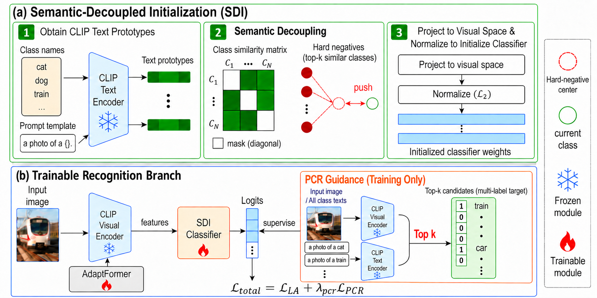
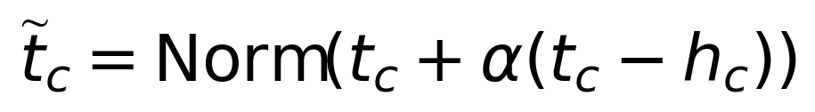
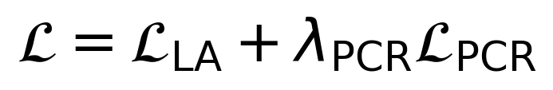

# SCR: Semantic Confusion Rectification for Parameter-Efficient Long-Tailed CLIP Adaptation

[](https://www.python.org/)
[](https://pytorch.org/)
[](LICENSE)

Code accompanying the paper **"Semantic Confusion Rectification for Parameter-Efficient Long-Tailed CLIP Adaptation"**.

> **Preview with figures displayed:** [Open the self-contained HTML README](README_with_embedded_images.html). The GitHub-rendered README below also displays the figures directly.

**Authors:** Xinyang Ma, Ao Guo, Zhongke Mao, Yuan Zheng, Huhe Dai  
**Affiliation:** Inner Mongolia University  
**Repository:** https://github.com/ZY-IMU-CV/SCR_MXY_2026

## Overview

Long-tailed CLIP adaptation can suffer from semantic confusion at **classifier initialization** and **downstream optimization**. We propose **Semantic Confusion Rectification (SCR)** with two complementary components:

- **Semantic-Decoupled Initialization (SDI)** separates each CLIP text prototype from its locally similar hard-negative classes *before training*.
- **Progressive Confusion Rectification (PCR)** uses predictions from **frozen zero-shot CLIP** to mine sample-specific confusing classes during training. The ground-truth class and the selected non-ground-truth classes provide a multi-label auxiliary target.

**Codebase and baseline:** This project is adapted from **[CUE](https://github.com/zhangruichi/CUE)**. We **retain CUE's VLM/CLIP-based instance-level semantic cues**, but **remove its LLM-based class-level cue module**. No LLM-generated class-relation JSON or LLM inference is required by the SCR SDI/PCR path. The existing CLIP + AdaptFormer tuning framework is retained.



*Figure 2. SCR model architecture. SDI constructs textual prototypes, mines semantic hard negatives, decouples each prototype, and initializes the classifier. During adaptation, a frozen zero-shot CLIP branch mines top-k non-ground-truth confusing classes; together with the ground-truth class they form the PCR multi-label target. Only AdaptFormer and the classifier are updated, and the guidance branch is removed at inference.*

During inference, the zero-shot CLIP/PCR guidance branch is not used. Training updates only AdaptFormer parameters and the classifier.

## Method details

### 1. Semantic-Decoupled Initialization (SDI)

For each normalized text prototype `t_c`, find the `k_SDI` most similar **other** class prototypes. Let their mean be `h_c`. The initialization is



The resulting prototype is used to initialize the classifier (with projection into the visual feature space for CLIP-ViT, where required). This operation is performed once before adaptation.

### 2. Progressive Confusion Rectification (PCR)

The frozen zero-shot CLIP branch selects the top-`k_PCR` non-ground-truth classes for each training image; these are combined with its ground-truth label to build an instance-level multi-label target. PCR uses binary logit adjustment alongside categorical logit-adjusted cross-entropy:



PCR is **VLM-only**: unlike the original CUE design, SCR does **not** use its LLM-derived class neighborhoods or associated class-level loss.

*Editable LaTeX sources for both equations are available in [`assets/equations.tex`](./assets/equations.tex).*

### Settings reported in the paper

| Parameter | Value |
|:--|:--|
| Backbone | CLIP ViT-B/16 |
| Adaptation | AdaptFormer + classifier (frozen CLIP backbone) |
| SDI neighbors `k_SDI` | 2 |
| SDI strength `alpha` | 0.7 |
| PCR neighbors `k_PCR` | 5 |
| PCR weight `lambda_PCR` | 0.1 |
| LA scales `tau`, `tau_b` | 1.0, 1.0 |
| Batch size | 128 |
| Optimizer | SGD, momentum 0.9, cosine LR schedule |
| Epochs | 10 (CIFAR-100-LT, ImageNet-LT, Places-LT); 20 (iNaturalist 2018) |

The default configuration enables SDI (`use_hn: True`) with `hn_topk=2`, `hn_alpha=0.7`, and sets PCR parameters `pcr_topk=5`, `pcr_weight=0.1`, `pcr_tau_b=1.0`. The CUE naming of the SDI flags is retained for existing ablation scripts. The `clip_vit_b16` model configuration enables AdaptFormer; dataset configurations provide the bottleneck dimensions reported in the paper.

## Results

Top-1 accuracy (%) **as reported in the paper**:

| Dataset | Without TTE | With TTE |
|:--|--:|--:|
| CIFAR-100-LT (IF=100) | **83.0** | **82.9** |
| ImageNet-LT | **77.2** | **78.6** |
| Places-LT | **51.7** | **52.5** |
| iNaturalist 2018 | **79.3** | **80.5** |

The paper also reports ablations for SDI and PCR and comparisons with **CUE** (CVPR 2026) and **LIFT** (ICML 2024). LIFT is an important parameter-efficient long-tail learning baseline in our experiments. These numbers are transcribed from the paper rather than generated by this packaging step.

## Installation

The original CUE-based project targets Python 3.8+, PyTorch 2.0 and torchvision 0.15. For example:

```bash
conda create -n scr python=3.8 -y
conda activate scr
conda install pytorch==2.0.0 torchvision==0.15.0 pytorch-cuda=11.7 -c pytorch -c nvidia
pip install -r requirements.txt
```

Choose a PyTorch/CUDA build compatible with your system. The source snapshot does not include pretrained CLIP weights or benchmark image datasets. The pretrained **CLIP ViT-B/16 checkpoint is not bundled** with this repository; when first used, the existing CLIP loader downloads it from the official model URL and caches it under `~/.cache/clip`. For offline training, put the checkpoint in that cache beforehand. The `clip/` folder contains the CLIP implementation and tokenizer, **not model weights**.

## Data and training

Download and prepare the datasets (CIFAR-100-LT, ImageNet-LT, Places-LT, or iNaturalist 2018). Update the `root` value in the matching `configs/data/*.yaml` file to the local image dataset location. Long-tailed split metadata is supplied under `datasets/`. Only the four benchmark dataset configurations and the `clip_vit_b16.yaml` model configuration used by SCR are included; unused configurations from the upstream baseline have been removed.

The existing CUE-style entry point and example commands are:

```bash
# CIFAR-100-LT, imbalance factor 100
python main.py -d cifar100_ir100 -m clip_vit_b16

# ImageNet-LT
python main.py -d imagenet_lt -m clip_vit_b16

# Places-LT
python main.py -d places_lt -m clip_vit_b16

# iNaturalist 2018
python main.py -d inat2018 -m clip_vit_b16 num_epochs 20
```

**Reproduction status:** The shared CUE utility modules are included in this release. The LLM-related `cue_utils.py` file, JSON relations and class-level loss are not part of SCR; VLM-based instance-level PCR is implemented in `utils/scr_utils.py`. Syntax and synthetic-tensor smoke checks do **not** establish end-to-end reproduction of the paper's accuracy. You will need CLIP pretrained weights, the benchmark datasets, GPU/CUDA environment, and a full training/evaluation run to verify results.

## Repository structure

```text
SCR_MXY_2026/
├── clip/                    # CLIP implementation
├── models/                  # Backbone wrappers, AdaptFormer and classifiers
├── datasets/                # Long-tailed dataset loaders and split metadata
├── configs/                 # Dataset/model configurations
├── utils/                   # CUE utility modules and SCR SDI/PCR functions
├── trainer.py               # CUE-based trainer with SCR SDI + PCR
├── main.py                  # CLI entry point
├── requirements.txt
└── LICENSE
```

## Acknowledgements

This repository is primarily adapted from the **CUE** codebase. We gratefully acknowledge **LIFT**, a foundational work on lightweight fine-tuning for long-tailed recognition and an important experimental baseline in our paper, as well as **CLIP** for its pretrained vision-language model. We sincerely thank the authors of these projects for sharing their research and code:

- **CUE** — [Concept-Aware Multi-Label Expansion to Mitigate Concept Confusion in Long-Tailed Learning](https://openaccess.thecvf.com/content/CVPR2026/html/Zhang_CUE_Concept-Aware_Multi-Label_Expansion_to_Mitigate_Concept_Confusion_in_Long-Tailed_CVPR_2026_paper.html) (CVPR 2026); [code](https://github.com/zhangruichi/CUE). **Primary codebase for SCR.**
- **LIFT** — [Long-Tail Learning with Foundation Model: Heavy Fine-Tuning Hurts](https://proceedings.mlr.press/v235/shi24g.html) (ICML 2024); [code](https://github.com/shijxcs/LIFT). **Foundational lightweight fine-tuning method and evaluation baseline.**
- **CLIP** — [Learning Transferable Visual Models From Natural Language Supervision](https://github.com/openai/CLIP) (ICML 2021). **Vision-language backbone.**

The MIT license from the supplied CUE-derived source is preserved with its original copyright notice.

## Citation

If you find this work useful, please cite:

```bibtex
@misc{ma2026scr,
  title={Semantic Confusion Rectification for Parameter-Efficient Long-Tailed CLIP Adaptation},
  author={Ma, Xinyang and Guo, Ao and Mao, Zhongke and Zheng, Yuan and Dai, Huhe},
  year={2026}
}
```

Please update the venue and bibliographic fields after publication.

Please also acknowledge and cite the relevant prior work, especially **CUE** (the primary codebase) and **LIFT** (a foundational method and experimental baseline).

**CUE (CVPR 2026)**

```bibtex
@inproceedings{zhang2026cue,
  title={CUE: Concept-Aware Multi-Label Expansion to Mitigate Concept Confusion in Long-Tailed Learning},
  author={Zhang, Ruichi and Shang, Chikai and Yang, Jiacheng and others},
  booktitle={Proceedings of the IEEE/CVF Conference on Computer Vision and Pattern Recognition},
  year={2026}
}
```

**LIFT (ICML 2024)**

```bibtex
@inproceedings{pmlr-v235-shi24g,
  title={Long-Tail Learning with Foundation Model: Heavy Fine-Tuning Hurts},
  author={Shi, Jiang-Xin and Wei, Tong and Zhou, Zhi and Shao, Jie-Jing and Han, Xin-Yan and Li, Yu-Feng},
  booktitle={Proceedings of the 41st International Conference on Machine Learning},
  series={Proceedings of Machine Learning Research},
  volume={235},
  pages={45014--45039},
  year={2024},
  publisher={PMLR},
  url={https://proceedings.mlr.press/v235/shi24g.html}
}
```
